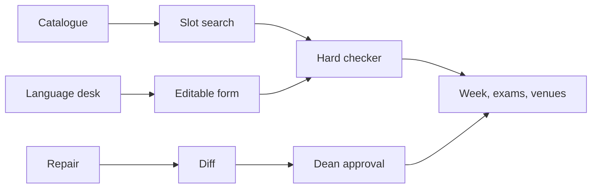

# CIT Board

Timetable, midsem seating and Spectra week venues for Chilika Institute of Technology.

The week runs Monday to Friday, P1 at 08:00 through P9 at 17:00, with lunch between P5 and P6. P10–P13 are for events only. A placement is accepted only when the checker inside this app says it is legal.

## Demo accounts

| Role | Email | Password |
| --- | --- | --- |
| Dean’s office | dean@cit.ac.in | harbour-dean |
| CSE coordinator | cse.coord@cit.ac.in | harbour-coord |
| Faculty (Dr. Leela Behera) | behera@cit.ac.in | harbour-faculty |
| Spectra club desk | spectra@cit.ac.in | harbour-club |

Nobody can approve their own request. The Dean’s office has **Reset demo data** under Office.

## What to try

1. Office → Generate week again. Hard clashes should read 0.
2. Week → switch group, faculty and room.
3. Venues → paste a Hinglish line, edit the form, submit. Read the reason.
4. Changes → Load sample change, then approve it as the Dean. Export `schedule_after.json`.
5. Desk → ask why a booking was moved, or mark a leave day.
6. Manual → try to drop a class on top of another. The checker blocks it.

## Stack

React, TanStack Start, Tailwind, Zustand. The timetable search, exam seating, booking rulings and repair all run in the browser. No model call is required, so the booking form still works if a language service is down.

## Layout

## Export

Office downloads `schedule.json` and, after a change is applied, `schedule_after.json`.

## Limits

The language desk is a rules reader for English and Hinglish patterns. Strange phrasing must be corrected on the form. The search is constructive, not a proof of the lowest possible soft score. The bundled catalogue matches the published counts (27 rooms, 40 faculty, 14 groups, 62 courses, 189 sessions, 243 hours, 41 papers, 25 requests). Office can replace it with a JSON file in that shape.
